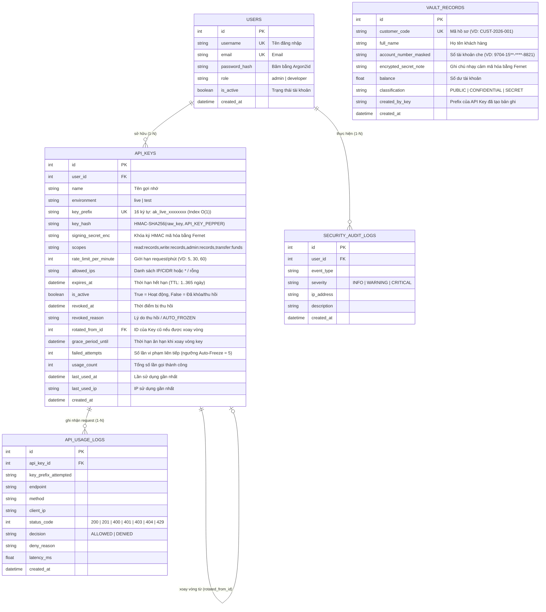

# ĐÁNH GIÁ HIỆN TRẠNG, THIẾT KẾ DATABASE & KỊCH BẢN DEMO ĐỒ ÁN
**Đề tài:** Xây dựng ứng dụng Web quản lý, cấp phát và kiểm soát API Key an toàn  
**Học phần:** Lập trình An ninh Thông tin  

---

## 1. Tổng quan Kiến trúc & Hiện trạng Dự án (Sau 3 vòng review & hardening)

Dự án đã được xây dựng hoàn chỉnh theo mô hình **Application Factory + Layered Security Architecture (MVC + Cryptographic Services + 6-Layer API Middleware)** và vượt qua toàn bộ **59 bài kiểm thử bảo mật tự động (`pytest`)**.

### 1.1. Cấu trúc thư mục hiện tại
```text
ANTT_CUoiKi/
├── app/
│   ├── __init__.py                # Khởi tạo Flask, validate_secrets, ProxyFix, Security Headers (CSP/HSTS)
│   ├── config.py                  # Cấu hình bảo mật, DEMO_MODE, validate_secrets, TestingConfig
│   ├── extensions.py              # Khởi tạo SQLAlchemy, Migrate, LoginManager, CSRFProtect, Limiter
│   ├── middleware/
│   │   └── api_auth.py            # Middleware 6 Lớp (@require_api_key) & Auto-Freeze IDS
│   ├── models/
│   │   ├── user.py                # Bảng users (Mật khẩu băm Argon2id, phân quyền role admin/developer)
│   │   ├── api_key.py             # Bảng api_keys (key_prefix 16 ký tự, key_hash HMAC-SHA256, signing_secret_enc Fernet)
│   │   ├── audit_log.py           # Bảng api_usage_logs & security_audit_logs
│   │   └── vault_record.py        # Bảng vault_records (account_number_masked, encrypted_secret_note Fernet)
│   ├── routes/
│   │   ├── auth.py                # Đăng nhập, Đăng ký, Quick-login (chỉ mở cho localhost khi DEMO_MODE=1)
│   │   ├── dashboard.py           # Quản lý vòng đời Key, RBAC chống IDOR, Playground, Logs, DB Inspector
│   │   └── api.py                 # REST API bảo vệ bởi @require_api_key (/records, /transfer, /demo/compute-hmac)
│   ├── services/
│   │   ├── crypto_service.py      # Argon2id, HMAC-SHA256 + Pepper, Fernet, HMAC Signature & Anti-Replay Cache
│   │   ├── key_service.py         # Cấp phát, Xoay vòng (Grace Period), Thu hồi (Revoke), Mở khóa (Unlock)
│   │   └── seed_service.py        # Khởi tạo dữ liệu mẫu cho 8 kịch bản (chỉ chạy khi DEMO_MODE=1)
│   ├── utils/
│   │   └── decorators.py          # Decorator @admin_required bảo vệ các trang quản trị
│   ├── static/css/style.css       # Giao diện Cybersecurity Dark Theme
│   └── templates/                 # Giao diện Jinja2 (login, register, dashboard, playground, logs, db_inspector)
├── tests/
│   ├── test_security_scenarios.py # 10 kịch bản kiểm thử chức năng & bảo mật cốt lõi
│   ├── test_vong1_fixes.py        # 24 kịch bản kiểm thử hardening vòng 1
│   ├── test_vong2_fixes.py        # 19 kịch bản kiểm thử hardening vòng 2
│   ├── test_vong3_fixes.py        # 6 kịch bản kiểm thử vòng 3 (429/401 JSON, gom bí mật vào .env)
│   └── conftest.py                # Bộ key demo "TESTONLY" cho test (không cần .env)
├── scripts/
│   └── tao_env.py                 # Sinh file .env chứa TOÀN BỘ bí mật (khóa server, mật khẩu & key demo)
├── .env                           # (KHÔNG commit) Mọi bí mật của dự án — sinh bằng scripts/tao_env.py
├── .env.example                   # Mẫu cấu trúc .env (chỉ có placeholder CHANGE_ME)
├── HUONG_DAN_CHAY.md              # Hướng dẫn cài đặt & chạy từng bước
├── CHANGELOG.md                   # Lịch sử review & sửa lỗi bảo mật (vòng 1 → 3)
├── pytest.ini                     # Cấu hình pytest
├── requirements.txt               # Thư viện chạy ứng dụng
├── requirements-dev.txt           # Thư viện kiểm thử (pytest)
├── run.py                         # Điểm vào chạy ứng dụng (mặc định FLASK_DEBUG=0)
└── seed.py                        # Script khởi tạo dữ liệu mẫu cho buổi thuyết trình Demo
```

---

## 2. Các Cơ chế An ninh Trọng tâm Đã Triển khai

| Hạng mục | Cơ chế Bảo mật trong Code | Chi tiết Kỹ thuật |
| :--- | :--- | :--- |
| **Sinh khóa (Key Generation)** | `secrets.token_urlsafe(24)` | Sinh phần secret với **24 byte entropy → 32 ký tự URL-safe**. Cấu trúc đầy đủ 4 phần: `ak_<live\|test>_<prefix>_<secret>`. |
| **Định danh Prefix (`key_prefix`)** | Lưu **16 ký tự** trong DB | Với key tạo mới: `ak_live_` + 8 ký tự hex (`secrets.token_hex(4)`). Với bộ key mẫu trong `DEMO_KEYS_CATALOG`: dùng định danh cố định 16 ký tự (VD: `ak_live_1001full`, không phải hex). |
| **Bảo vệ Khóa & Bí mật (`validate_secrets`)** | HMAC-SHA256 + Pepper & Fernet | Không có secret mặc định trong `Config`. Hàm `validate_secrets(app)` bắt buộc `SECRET_KEY`, `API_KEY_PEPPER`, `MASTER_ENCRYPTION_KEY` phải có độ dài $\ge 32$ và khác giá trị mẫu trong `.env.example`. |
| **Kiểm soát Chế độ Demo (`DEMO_MODE`)** | `DEMO_MODE = os.environ.get("DEMO_MODE", "0") == "1"` | Mặc định tắt (`0`). Khi tắt: `/auth/quick-login/*`, `/playground`, `/db-inspector`, `/api/v1/demo/compute-hmac`, `/dashboard/reset-demo` trả về `404`; header `X-Simulated-IP` bị bỏ qua; ứng dụng không tự động seed dữ liệu mẫu. |
| **Phân quyền & Chống IDOR** | `@admin_required` & Ownership Check | User `developer` chỉ thấy key của mình trên `/dashboard`, không thể rotate/revoke/unlock key của người khác (`403`), không thể tự cấp scope `admin:records` hay `transfer:funds` (`400`), và không thể truy cập `/db-inspector`, `/logs`, `/dashboard/reset-demo` (`403`). |
| **Kiểm soát IP & Proxy (`TRUST_PROXY`)** | `ipaddress.ip_network(rule, strict=False)` | Mặc định chỉ lấy `request.remote_addr` (không đọc `X-Forwarded-For` trừ khi bật `TRUST_PROXY=1` qua `ProxyFix`). Giá trị `*` hoặc rỗng `""` cho phép mọi IP; địa chỉ IP client không hợp lệ bị từ chối (`False`). Khi trả lỗi `403 IP_NOT_WHITELISTED`, không tiết lộ `allowed_ips`. |
| **Chống Replay Attack (`REPLAY_DETECTED`)** | Timestamp $\pm 300\text{s}$ + `_SEEN_SIGNATURES` | Sau khi xác thực `HMAC-SHA256` hợp lệ, cặp `(key_id, signature)` được lưu vào `_SEEN_SIGNATURES` trong 300s. Gửi lại cùng gói tin đã ký lần thứ 2 sẽ bị chặn `401` với `error_code = "REPLAY_DETECTED"`. |
| **Đóng băng Tự động (`Auto-Freeze IDS`)** | Ngưỡng `AUTO_FREEZE_THRESHOLD = 5` | Đếm mọi lần vi phạm liên tiếp sau khi đã xác thực đúng Key: sai IP ở Lớp 3 (`IP_NOT_WHITELISTED`), thiếu quyền ở Lớp 4 (`INSUFFICIENT_SCOPE`), và sai chữ ký/timestamp/replay ở Lớp 6 (`INVALID_HMAC_SIGNATURE_TAMPERED`, `TIMESTAMP_EXPIRED_REPLAY_DETECTED`, `REPLAY_DETECTED`). Đủ 5 lần sẽ khóa cứng sang `AUTO_FROZEN`. Sai secret không được đếm vào auto-freeze để tránh kẻ tấn công chỉ biết prefix có thể khóa key của người khác; brute-force được chặn bằng rate limit 120 request/phút/IP trên toàn bộ `/api/v1`. |

---

## 3. Thiết kế Schema Database (5 Bảng dữ liệu phục vụ Quản lý & Demo)

Hệ thống sử dụng **SQLAlchemy ORM** (mặc định lưu tại `instance/secure_api_manager.db` bằng SQLite để chạy ngay, hỗ trợ chuyển sang MySQL qua `DATABASE_URL` trong `.env`):



---

## 4. Thiết kế 8 Ngữ cảnh & Tình huống Demo Thực chiến (`DEMO_MODE=1`)

Khi bật `DEMO_MODE=1` và chạy `python seed.py`, hệ thống khởi tạo sẵn dữ liệu mẫu cho 8 kịch bản bảo mật:

1. **Ngữ cảnh 1 — Cấp phát "Show-Once" & Xác thực Chuẩn (`200 OK`)**:
   - Tạo Key mới (24 byte entropy → 32 ký tự secret, `key_prefix` 16 ký tự). Plaintext Key được render trực tiếp trong HTTP response của POST (không lưu vào `session`).
   - Dùng **Key 1 (`full_access`, `rate_limit = 60` req/phút)** gọi `GET /api/v1/records` trả về `200 OK` kèm dữ liệu giải mã `encrypted_secret_note`.
2. **Ngữ cảnh 2 — Kiểm soát Phân quyền Đặc quyền Tối thiểu (`Scope-based Access Control`)**:
   - **Key A (`read_only`)**: Chỉ có scope `read:records` (`rate_limit = 30`). Gọi `POST /api/v1/records` bị chặn **`403 Forbidden`** với `error_code = "INSUFFICIENT_SCOPE"`, `required_scopes = ["write:records"]` (không tiết lộ `granted_scopes`).
   - **Key B (`full_access`)**: Có đủ `read:records,write:records,admin:records,transfer:funds` (`rate_limit = 60`). Gọi `POST /api/v1/records` thành công **`201 Created`**.
3. **Ngữ cảnh 3 — Kiểm soát Địa chỉ Mạng (`IP Whitelisting & CIDR`)**:
   - **Key C (`ip_restricted`)**: Cấu hình `allowed_ips = "127.0.0.1, 10.10.0.0/16"`.
   - Khi `DEMO_MODE=1`, giả lập gọi từ `X-Simulated-IP: 185.220.101.45` bị chặn **`403 Forbidden`** với `error_code = "IP_NOT_WHITELISTED"` (không tiết lộ danh sách `allowed_ips` trong JSON trả về).
4. **Ngữ cảnh 4 — Kiểm soát Vòng đời Khóa (`API_KEY_EXPIRED` & `API_KEY_REVOKED`)**:
   - **Key 4A (`expired_key`)**: Trả về **`401 Unauthorized`** (`error_code = "API_KEY_EXPIRED"`).
   - **Key 4B (`revoked_key`)**: Trả về **`401 Unauthorized`** (`error_code = "API_KEY_REVOKED"`, không tiết lộ `revoked_reason`). Key đã `REVOKED` không thể được unlock hay rotate (`400`).
5. **Ngữ cảnh 5 — Xoay vòng Khóa Không gián đoạn (`Zero-Downtime Key Rotation`)**:
   - Chỉ cho phép Rotate các Key đang hoạt động (`ACTIVE`). Key cũ chuyển sang trạng thái `GRACE_PERIOD` và khi gọi API vẫn trả về `200 OK` kèm Header `X-API-Key-Deprecated: true` và `X-API-Key-Sunset`.
6. **Ngữ cảnh 6 — Chống Spam / DDoS theo từng Key (`Per-Key Rate Limiting`)**:
   - **Key 6 (`rate_limited_free`)**: Giới hạn `5` requests/phút. Bắn liên tiếp 7 requests -> 5 request đầu `200 OK`, request thứ 6 & 7 bị chặn **`429 Too Many Requests`** (`error_code = "RATE_LIMIT_EXCEEDED"`).
7. **Ngữ cảnh 7 — Tự động Đóng băng Key khi Phát hiện Dò quét (`Auto-Freeze IDS`)**:
   - **Key 7 (`intrusion_target`)**: Sau 5 lần vi phạm bảo mật liên tiếp (sai IP ở Lớp 3, thiếu scope ở Lớp 4, hoặc sai chữ ký HMAC ở Lớp 6), Key tự động chuyển sang `AUTO_FROZEN`. Lần gọi thứ 6 dù hợp lệ cũng bị chặn **`401`** (`error_code = "API_KEY_AUTO_FROZEN"`). Chỉ các Key `AUTO_FROZEN` mới được phép mở khóa (`unlock`).
8. **Ngữ cảnh 8 — Chữ ký số `HMAC-SHA256` & Chống Replay Attack / Sửa dữ liệu (`POST /api/v1/transfer`)**:
   - Kiểm tra chặt chẽ `customer_code` tồn tại (`404` nếu không thấy) và `amount` bằng `Decimal` (từ chối `400` nếu $\le 0$, `NaN`/`Infinity`, hoặc lớn hơn `balance`).
   - **8A (Chuẩn)**: Chữ ký và Timestamp hợp lệ -> **`200 OK`**.
   - **8B (Replay Attack)**: Timestamp lệch quá 300s -> **`401`** (`error_code = "TIMESTAMP_EXPIRED_REPLAY_DETECTED"`); hoặc gửi lại đúng gói tin đã ký lần thứ 2 trong 300s -> **`401`** (`error_code = "REPLAY_DETECTED"`).
   - **8C (MITM Tampering)**: Sửa nội dung body trên đường truyền -> **`401`** (`error_code = "INVALID_HMAC_SIGNATURE_TAMPERED"`).
